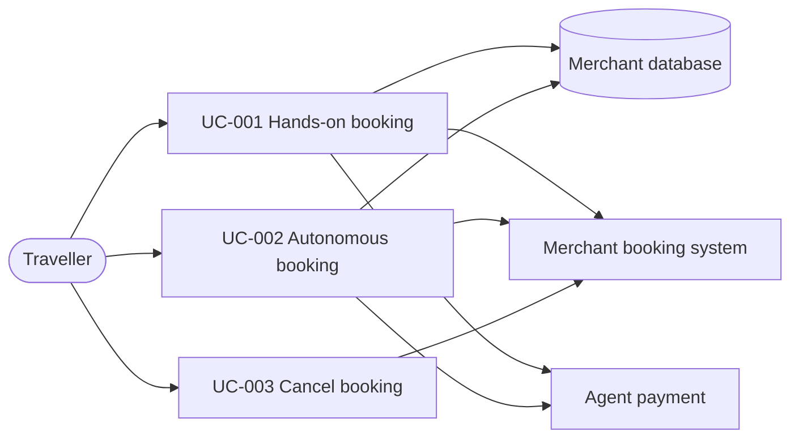
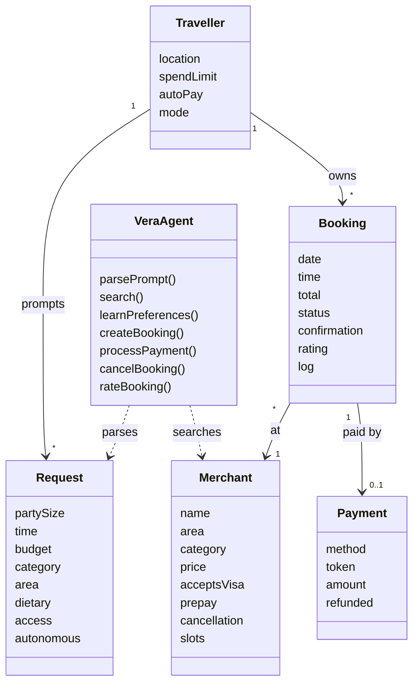

# VERA: Concept

**Working title:** V.E.R.A., Visa Experience and Reservation Agent (concept name for an academic project)

VERA is an agentic-commerce concierge. The traveller can let it act fully autonomously or keep some control,
using voice or text prompts. It removes the need to juggle several apps to find activities and handle
reservations. VERA searches for activities and restaurants based on the prompt, learned preferences, current
location and time. It builds a personalised plan, makes reservations (autonomously or after confirmation) and
pays securely when a booking requires payment and the user has allowed it, always within the user's price limits.

## Key assumptions

- The user can use the system and has accepted the terms of service.
- Merchants that accept Visa have adopted an agent-to-agent booking protocol.
- The AI does not hallucinate. In reality this is the biggest risk, so the prototype logs every decision.
- Agentic commerce is accepted by users in the target countries.

## ECHO: the Traveller

A Visa cardholder exploring an unfamiliar place, who uses an agent to search, reserve and pay, only with
merchants that accept Visa.

- **Transformation (T):** from travellers who plan everything manually → to explorers effortlessly guided by a trusted AI agent.
- **Worldview (W):** safe automation makes experiences as effortless as intention.

## Holons (TWO-CE)

### 1. Discover merchants

Identify merchants that accept Visa, using the merchant database and public merchant information, to find
options that fit the prompt.

| | |
| --- | --- |
| T | Prompt with location and activity/restaurant → options list |
| W | AI agents can optimise search experiences |
| O | VERA agent |
| C | Travellers with a Visa card |
| E | Payment-network infrastructure and merchants' public information (websites, APIs) |

Efficacy: response < 1s, 95% match accuracy · Efficiency: API cost < 50% of transaction revenue · Effectiveness: builds trust in and use of the travel ecosystem.

Verbs: *user enters prompt → agent looks up Visa-accepting merchants → checks public info → aligns with preferences → provides options.*

### 2. Select and personalise

Align search results with user preferences to produce a personalised plan.

| | |
| --- | --- |
| T | Merchant data → personalised plan |
| W | Intelligent personalisation creates more relevant experiences and higher satisfaction |
| O | VERA agent |
| C | Merchants accepting Visa |
| E | Merchant database and merchant websites |

Verbs: *agent displays plan → traveller confirms (hands-on) or agent decides (autonomous) → agent books.*

### 3. Pay securely

Pay for reservations through agent-payment and Click to Pay-style infrastructure to secure bookings.

| | |
| --- | --- |
| T | Card token and selection → confirmed booking |
| W | A trusted agent protocol and digital handshake make agent payments secure and authentic |
| O | VERA team |
| C | Travellers paying merchants |
| E | Payment infrastructure, trusted agent protocol, merchant booking systems |

Verbs: *agent checks price limit → handshake with merchant's agent → processes payment → sends confirmation.*

## Use cases

| ID | Name | Goal | Trigger | Postcondition |
| --- | --- | --- | --- | --- |
| UC-001 | Hands-on booking | User picks from the agent's options list | Prompt in chat | User has selected, confirmed and (if needed) paid. Nothing happens without the user's input |
| UC-002 | Autonomous booking | Agent books the best match itself | Prompt in chat (autonomous mode or "just book it") | Booking confirmed and paid if required and within the limit |
| UC-003 | Cancel a booking | Cancel an active booking | Bookings tab | Cancelled (refunded if paid), **or** refused by the merchant's policy and still active |

Supporting actors: merchant database, web/API lookup, merchant booking system.

## Class diagram (as implemented)

## Five-year roadmap

- **Maps integration:** routes and live navigation to each booked experience.
- **Smart mobility booking:** the agent books a ride from the traveller's location to the experience.
- **Calendar sync:** bookings added to Google, then Apple and Outlook, calendars automatically.
- **Merchant scoring:** an internal rating system that feeds back into recommendations and service quality.
- **Accessibility:** expand beyond voice and step-free/dietary filters to neurodiversity, sensory and cognitive accessibility.

## FAQ (summary)

**Business model.** Users get a card-only discount of 20% in year one, then 10% and 5%. Participating
merchants get a 20% reduction in network fees. 20% of commission goes to a reserve fund for contingencies.

**Reach.** Phase 1 targets existing cardholders through in-app promotions, newsletters and loyalty programmes.
Phase 2 uses AI-powered travel perks to attract new cardholders.

**When things go wrong.** Every agent action is recorded in an incident report. In the prototype, this is the
agent log on each booking. A customer-care team uses it to decide which scenario applies:
1. Merchant-side problem (closure etc.): the merchant refunds.
2. Agent caused the mismatch: refunded through purchase-protection insurance.
3. User's prompt caused it: the user is responsible.
This process is in the terms and is shown to the user the first time they use the agent.

**Local data.** Public data from reputable sources, merchant scoring, open travel directories and in-app reviews.

**Accessibility.** Speech-to-text and text-to-speech, plus accessibility and dietary needs as search filters.

**Target.** The aspirational everyday traveller, who values experiences over logistics and wants quality without
excess luxury.
